# **Full Stream Ahead: Breaking the Protocol Barrier with http4k**

Speaker: Ivan Sanchez (Independent Consultant)

KotlinConf 2025 · May 2025 · 43-minute session

## Abstract

HTTP's request-response pattern has served us well, but modern web applications
demand more. Real-time communication demands different protocols, yet
maintaining testability and simplicity remains crucial to developer experience.

In this talk, we'll explore how http4k extends HTTP's capabilities through
WebSocket and Server-Sent Events support and how these protocols can be modelled
as simple functions, making them as testable as plain HTTP endpoints. We'll then
show how these streaming capabilities open up new possibilities for server-side
rendering, bringing us full circle from the days of JSP to modern reactive
interfaces - all while keeping the complexity on the server where it belongs.

Join us to discover how http4k's streaming capabilities can enhance your web
applications, enabling everything from chat applications to live dashboards and
reactive server-rendered interfaces.

## **1. The problem: traditional HTTP request-response**

Traditional web applications use the HTTP request-response model.

The client initiates a request, the server processes it, and the server returns
a response.

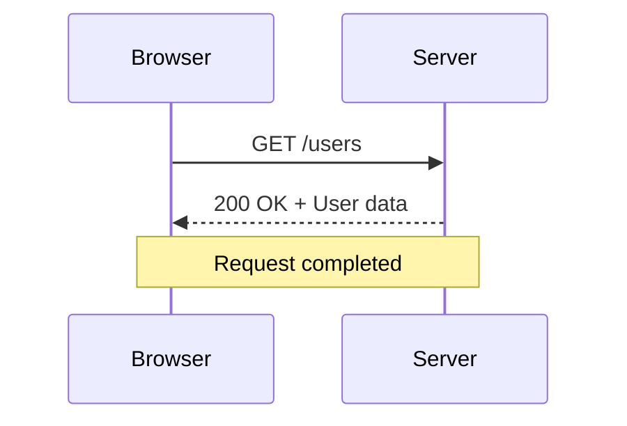

This works very well for:

- Loading pages.
- Retrieving information.
- Submitting forms.
- Creating and updating resources.
- Querying databases.

However, there is a limitation: the server cannot spontaneously send another
ordinary HTTP response after the request has finished.

Imagine a dashboard monitoring several services. If a service changes its
status, the browser needs to know about it.

Traditional approaches include:

- Polling the server periodically.
- Refreshing the page.
- Using additional communication protocols.

Polling works, but it can introduce unnecessary requests, latency and resource
consumption.

The fundamental challenge is therefore:

**How can we support continuous communication without introducing unnecessary
architectural complexity?**

## **2. Understanding the communication protocols**

The talk explores how different communication protocols can be used to solve
this problem.

### **2.1 HTTP: request-response**

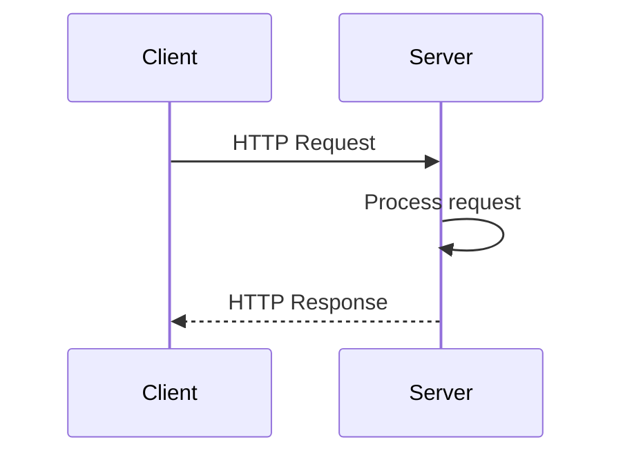

The client initiates communication.

The server responds, and the interaction ends.

### **2.2 Server-Sent Events (SSE)**

SSE allows the server to send multiple events to a client through a persistent
HTTP connection.

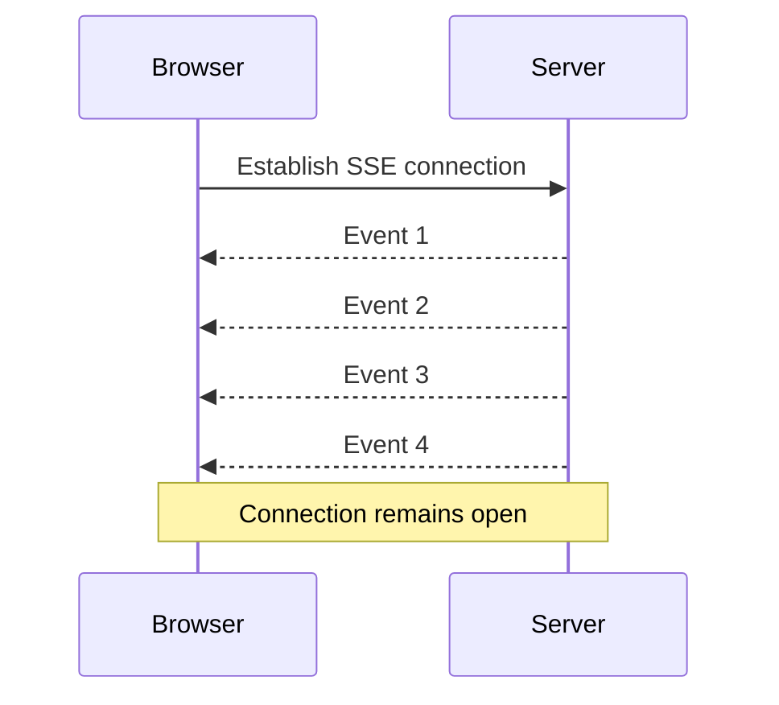


The important characteristic is that communication is primarily unidirectional:

- The browser establishes the connection.
- The server sends events.
- The browser receives updates continuously.

Typical use cases include:

- Notifications.
- Monitoring dashboards.
- Live feeds.
- Progress indicators.
- Real-time status updates.

### **2.3 WebSockets**

WebSockets provide bidirectional communication.

Both parties can send messages independently after establishing the connection.

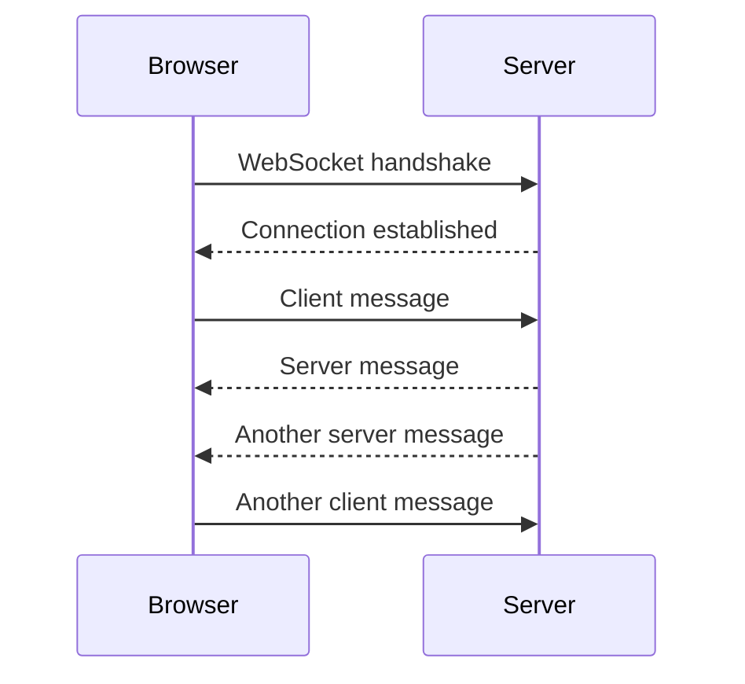

Typical use cases include:

- Chat applications.
- Multiplayer games.
- Collaborative editing.
- Real-time trading.
- Interactive applications.

### **Comparing the three protocols**

| Capability              | HTTP                    | SSE                          | WebSockets                |
| ----------------------- | ----------------------- | ---------------------------- | ------------------------- |
| Client sends requests   | Yes                     | Yes, to establish connection | Yes                       |
| Server pushes updates   | Not after response ends | Yes                          | Yes                       |
| Bidirectional streaming | No                      | No                           | Yes                       |
| Persistent connection   | Not normally            | Yes                          | Yes                       |
| Typical use             | APIs                    | Notifications                | Interactive communication |

The important observation is that these protocols have different communication
characteristics, but developers should not necessarily need completely different
programming models to use them.

## **3. The http4k approach: Protocols as functions**

This is the central architectural idea of the presentation.

http4k is a Kotlin HTTP toolkit built around functional programming.

An ordinary HTTP handler can be represented as a function:

```
typealias HttpHandler = (Request) -> Response
```

Conceptually, the handler receives an HTTP request and returns an HTTP response.

```
fun handleRequest(request: Request): Response {
    return Response(Status.OK)
        .body("Hello, world!")
}
```

This simple abstraction has several advantages:

- The handler is a function that can be tested independently.
- Its dependencies can be controlled.
- Its behavior can be composed with other functions.
- It doesn't need to be coupled to a particular web server implementation.

However, what happens when the response is not a single object, but a continuous
stream of events?

This is where the talk becomes particularly interesting.

### **From ordinary responses to streaming responses**

With SSE, the server doesn't return just one response body and finish. It
establishes a connection and produces a sequence of events.

With WebSockets, the server and client exchange messages over a persistent,
bidirectional connection.

http4k provides functional abstractions for these communication mechanisms,
allowing developers to retain familiar ideas such as function composition and
testing.

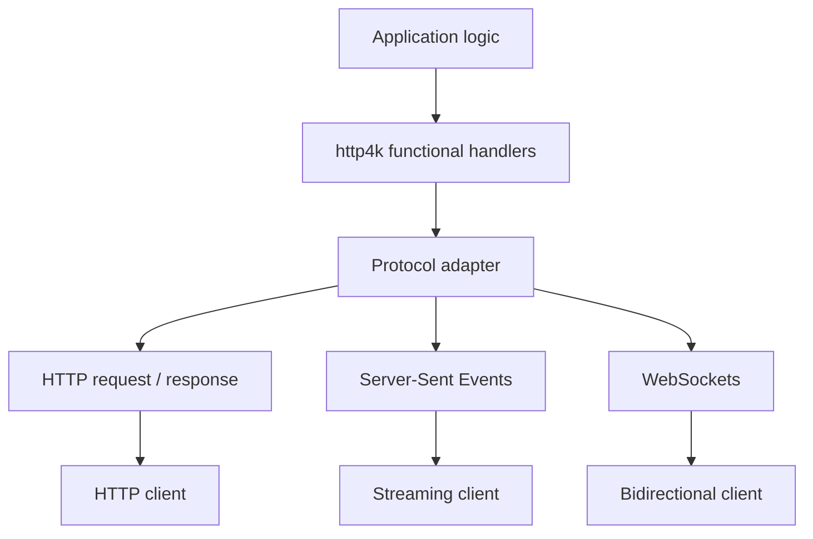

The important distinction is that the protocols remain different. The objective
is not to make them identical, but to make them easier to work with using
consistent programming principles.

[image](https://www.google.com/s2/favicons?domain=https://sessionize.com\&sz=32)

sessionize.com+1

## **4. The practical example: DataStar instead of HTMX**

Now let's examine the screenshot you provided.

The demonstration uses DataStar.

DataStar is a framework for building reactive web applications using HTML
attributes, signals, and server-driven updates.

Unlike a traditional SPA, it doesn't require developers to build and maintain a
large JavaScript application to manage every interaction.

Its programming model is particularly interesting because it combines:

- HTML as the interface description.
- Signals as reactive client-side state.
- Server-Sent Events as a streaming transport.
- Server-generated HTML fragments to update the DOM.

The screenshot demonstrates two interactions:

1. Loading a list of users when the page opens.
2. Updating the application's signals when the user clicks an element.

Let's break them down.

### **4.1 Initial HTML page**

The left-hand side of your screenshot shows the initial HTML:

```
<html lang="en">
    <script src="https://cdn/datastar.js"></script>

    <ul id="users"
        data-on-load="@get('/users')"/>

    <div data-signals="[]"
         data-on-click="@get('/data')"></div>
</html>
```

There are two important elements.

**First: the users list**

```
<ul id="users"
    data-on-load="@get('/users')"/>
```

The `data-on-load` attribute tells DataStar to execute a GET request when the
element loads.

In this example:

```
GET /users
```

**Second: the signals element**

```
<div data-signals="[]"
     data-on-click="@get('/data')"></div>
```

The `data-signals` attribute initializes reactive state.

The `data-on-click` attribute defines an action to execute when the user clicks
the element.

In this example:

```
GET /data
```

Notice that the HTML describes the behavior declaratively.

We don't need to write a JavaScript event listener manually for these
interactions.

### **4.2 First interaction: loading users**

When the page loads, DataStar executes:

```
GET /users
```

The server responds using an SSE event.

The screenshot represents the event as:

```
event: merge-fragments

data: <ul id="users">
        <li>user1</li>
      </ul>
```

The purpose of this event is to tell DataStar to merge an HTML fragment into the
existing DOM.

The original empty users list is replaced or updated with the HTML fragment
containing `user1`.

The complete sequence is:

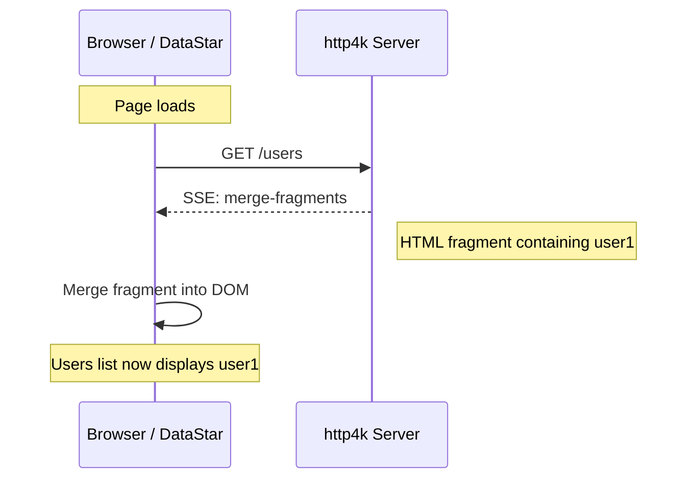

The important thing is that the server doesn't return an entire new page.

It sends a fragment that DataStar knows how to merge into the existing document.

This is a server-driven DOM update.

### **4.3 Second interaction: updating signals**

The second part of the screenshot demonstrates a different capability.

The user clicks the element:

```
<div data-signals="[]"
     data-on-click="@get('/data')"></div>
```

DataStar executes:

```
GET /data
```

The server responds with another SSE event:

```
event: merge-signals

data: [{ user1 }]
```

The intention is to merge the returned data into the existing reactive signals.

This is different from the first example.

- `merge-fragments` updates the DOM.
- `merge-signals` updates the reactive state.

The sequence looks like this:

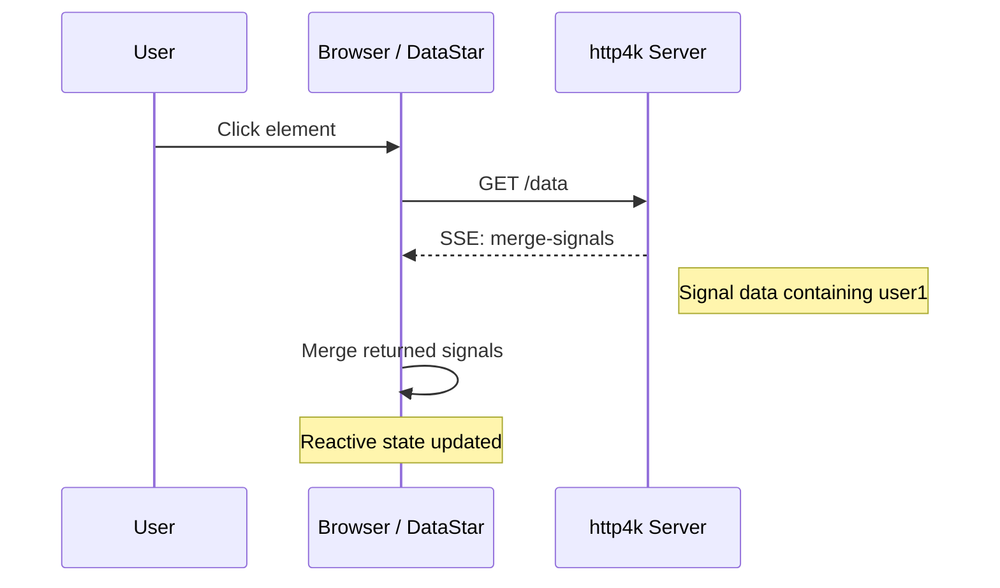

### **4.4 Understanding the complete screenshot**

The two interactions can be combined into one diagram:

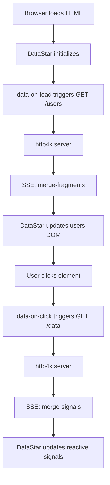
Conceptual interpretation of the two interactions in your screenshot.

This is a very useful distinction:

**The server can update either the HTML displayed by the browser or the reactive
state maintained by DataStar.**

It can do so through the same streaming communication mechanism.

One technical detail: the screenshot simplifies the SSE event names and
payloads. In DataStar's actual protocol, these are represented by
DataStar-specific event types and their corresponding payload formats.

## **5. Why DataStar is interesting in this architecture**

Let's compare a traditional SPA approach with the DataStar approach.

### **Traditional SPA**

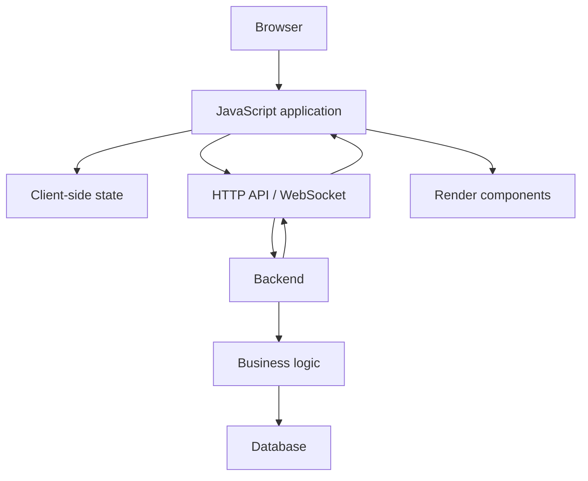

The frontend is responsible for:

- Managing application state.
- Handling user interactions.
- Processing API responses.
- Updating the interface.
- Synchronizing state with the backend.

This is a perfectly valid architecture, especially for complex client-side
applications.

However, it introduces another substantial application layer.

### **DataStar with http4k**

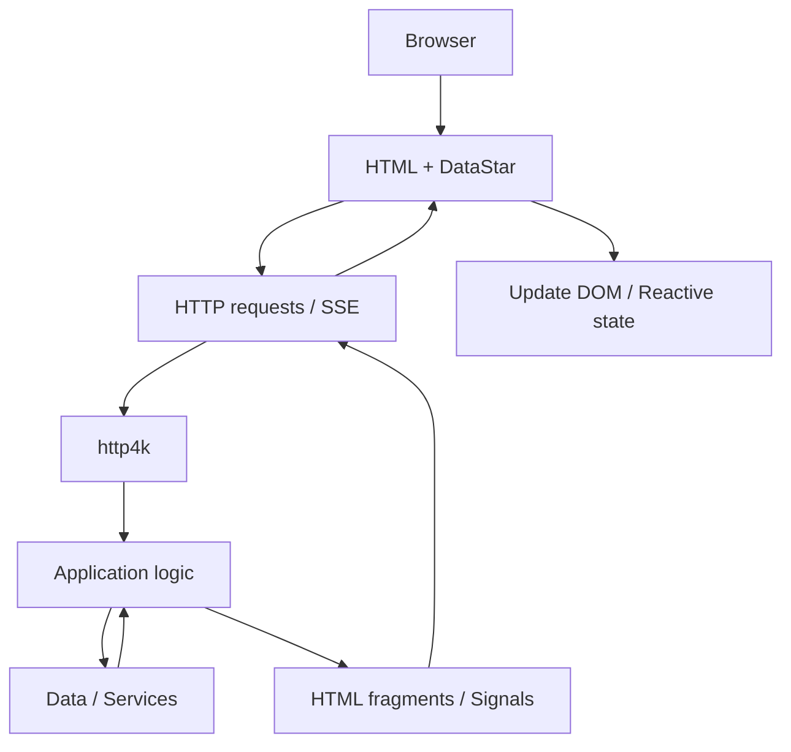


Here, the server has more responsibility for deciding what should happen and
what the browser should display.

DataStar provides the browser-side mechanisms for:

- Triggering requests.
- Maintaining reactive signals.
- Receiving SSE events.
- Updating HTML fragments.
- Synchronizing the interface with server responses.

The result is an architecture where much of the application logic remains on the
server.

**The key idea is not eliminating JavaScript altogether. It is avoiding the need
to build a large JavaScript application when the problem doesn't require one.**

## **6. How does this relate to server-side rendering?**

This is one of the most interesting architectural implications of the
presentation.

Historically, web applications often generated HTML on the server using
technologies such as JSP, PHP, or server-side templates.

The server generated the page, and the browser displayed it.

Later, Single Page Applications moved much of the presentation logic and state
management to the browser.

The presentation demonstrates a possible middle ground:

**Server-side rendering combined with reactive, real-time browser updates.**

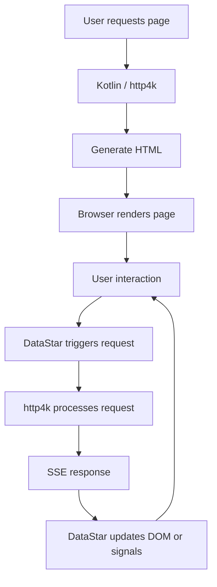

This architecture combines the advantages of both approaches:

| Traditional server rendering | Modern reactive applications |
| ---------------------------- | ---------------------------- |
| HTML generated on server     | Reactive interface           |
| Business logic on server     | Partial DOM updates          |
| Simple initial rendering     | Real-time communication      |
| Less client-side state       | Signals and event handling   |

This is particularly attractive for business applications, dashboards,
administration systems and monitoring interfaces.

## **7. What does the http4k example repository demonstrate?**

The speaker published a repository containing the examples associated with the
presentation.

Repository:
[http4k/full-stream-ahead](https://github.com/http4k/full-stream-ahead?utm_source=chatgpt.com)

It is worth exploring because the examples progress through the different
communication models.

| Example                  | What it demonstrates                       |
| ------------------------ | ------------------------------------------ |
| `01_http_template`       | Traditional HTTP with Handlebars templates |
| `02_http_api`            | REST API with JSON responses               |
| `03_ws`                  | Bidirectional WebSocket communication      |
| `04_sse`                 | Server-to-client SSE streaming             |
| `05_datastar`            | Basic http4k and DataStar integration      |
| `06_datastar_demo`       | Reactive application with user management  |
| `07_datastar_gameoflife` | Conway's Game of Life using DataStar       |

[image](https://www.google.com/s2/favicons?domain=https://github.com\&sz=32)

GitHub+1

I particularly recommend looking at the last three examples.

The Game of Life example is interesting because it demonstrates that the same
architecture can support continuously changing interfaces, not just simple form
submissions or user lists.

## **8. What are the main lessons from the presentation?**

I would summarize the session into six important lessons.

| Lesson                        | What it means                                                                                          |
| ----------------------------- | ------------------------------------------------------------------------------------------------------ |
| Protocol independence         | HTTP, SSE and WebSockets can be supported through consistent functional programming principles.        |
| Functional programming        | Communication handlers can be modelled as composable and testable functions.                           |
| Streaming                     | Applications can continuously exchange information without repeatedly initiating independent requests. |
| Server-driven UI              | The server can generate HTML fragments and determine how the interface changes.                        |
| Reactive state                | DataStar signals provide a way to maintain and update client-side state.                               |
| Simpler frontend architecture | Interactive applications don't necessarily require a large SPA framework.                              |

